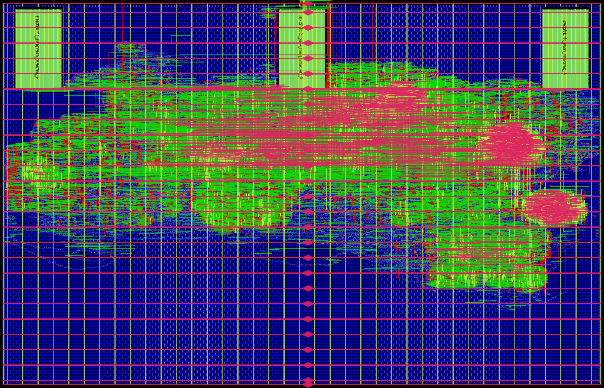

# RISCay-MCU

A small reusable RV32E microcontroller built in Chisel with
[chisel-async](https://github.com/BiscutLabs/chisel-async). Two independent SoC
implementations are maintained: [four-phase bundled data](designs/four-phase-bd/README.md)
and [native two-phase Click](designs/two-phase-click/README.md). **BD is the selected
tape-out implementation; Click is frozen as a tested functional reference.**
Physical qualification is still required. They share the ISA,
interface schemas, fixed SRAM models and verification utilities. Click has no
hidden four-phase adapters.

RISCay is a generic MCU. Application policy belongs in uploaded firmware, including
Groundlark power supervision. Profiles supply pin names, measurement metadata and
capacities; neither RTL nor mask ROM contains profile-specific behavior.

## Boot, memory and peripherals

The generic boot ROM validates an image in external SPI NOR flash using the
existing compatibility rules and CRC, then runs it from executable SRAM. Blank,
corrupt or incompatible storage falls back to the I2C host loader. Explicit,
unlocked persistence can write a host-uploaded image back to flash. SPI is
bit-banged through ordinary GPIOs, with a generic claim/drain/release interface
when sharing the ADC bus. See the [boot contract](docs/generic-boot-contract.md).

The reference capacity is 2 KiB executable SRAM plus 1 KiB working SRAM, implemented
with three pinned GF180 macros. Capacities remain build parameters. GPIO, events,
measurements, deadlines, sleep leases and application registers use the common
[MMIO/host contract](docs/soc-contract.md). The programming lock lasts until POR;
SRAM, image and lock retention across watchdog recovery are explicit. POR makes
all GPIOs inputs. A generic option controls ordinary GPIO retention on watchdog
reset; SPI recovery always releases its outputs. Board pull resistors define the
safe electrical state.

The independent LF timebase/watchdog and reset qualifier remain clocked. Native
owners implement CPU/fabric, loader/MMIO state, telemetry, arithmetic and protocol
sequencing; service coordination, some publication boundaries, wire sampling and
production SRAM macro access still use clocks. The
[remaining-state ledger](docs/async-residual-state.md) records those boundaries.
Experimental self-timed SRAM is isolated from the production path.

## Verification

```text
python tools/ci.py --output build/ci-local
```

[Build and test](docs/build-and-test.md) describes the pinned JDK, firtool, simulator
and library setup. The GitHub workflow runs Python properties and fast Scala RTL suites on
main pushes and pull requests once published; the first hosted run is pending.
Extended boot, SRAM, reset and firmware suites
remain required when those subsystems change.

The [test-suite cleanup](docs/test-suite-cleanup.md) reduces 1,202 Python tests to
292 and replaces completed-step checker campaigns with generation-time library
rules, mapped graph proofs and behavioral chip tests. It explicitly lists coverage
that was retired. Current export checks consume a typed structural audit without
rewriting generated testbenches. This audit is separate from reset-domain and
physical timing checks.

## Physical status



The current **BD digital top is placed and routed on a 3.93 × 2.53 mm outline**
(9.9429 mm²), with zero detailed-router DRC violations. Cell footprints total
**3.629 mm²**, including **2.896 mm² logic**, **0.466 mm² SRAM** and
**0.267 mm² taps/endcaps**. The image comes directly from the routed OpenROAD
database; the three SRAM macros are across the top. Pads and analog blocks are
not included. See the [run and reproduction notes](docs/gf180-bd-rectangular-pnr.md).

**Physical timing is unqualified.** Nominal/minimum/maximum wire RC extraction is
complete, but electrical violations and full async timing, mismatch, reset,
macro and analog/pad qualification remain open. The [area ledger](docs/area-ledger.md)
separates mapped, repaired and routed costs; these are not measured deep-sleep
power. The [original routed experiment](docs/gf180-first-pnr.md) remains historical.

The [migration checklist](docs/async-soc-migration.md) and
[native area plan](docs/native-area-reduction.md) track the remaining work. Historical
measurements and reviews stay in the documentation; active verification commands
live in the build guide. The [GF180 estimates](docs/gf180-estimates.md) distinguish
area and listed-state leakage estimates from measured whole-chip power.

Groundlark is an external firmware/application integration. Its MCU pin metadata,
shared ADC/boot-flash wiring and pin budget are documented in
[Groundlark I/O](docs/groundlark-io.md) and its [profile](profiles/groundlark/README.md).
This workstream does not modify or port the Groundlark application repository.

Project licensing is recorded in [LICENSE](LICENSE). Reused third-party material
retains its own license and attribution.
