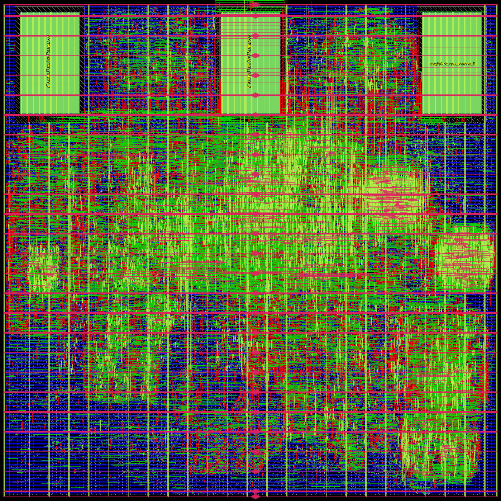

# RISCay-MCU

RISCay-MCU is an asynchronous RV32E microcontroller built in Chisel with
[chisel-async](https://github.com/BiscutLabs/chisel-async), targeting the GF180MCU
process. It combines a small RISC-V CPU, on-chip SRAM, firmware loading, GPIO,
measurement interfaces and event-driven sleep.

The project has two independent implementations: **four-phase bundled data (BD)**
and **native two-phase Click**. BD is the primary implementation for physical
development; Click is maintained as a functional reference. Both use the same
ISA and software interfaces.

## Features

| Component | Capabilities |
| --- | --- |
| CPU | RV32E, sixteen 32-bit registers, one instruction in flight; no cache, compressed instructions or hardware multiply/divide |
| Memory | 2 KiB executable SRAM and 1 KiB working SRAM in the reference build; configurable capacities |
| Boot | ROM bootloader reads and validates firmware from external SPI NOR flash, with I²C host-loader fallback |
| Programming | CRC and image-compatibility checks, programming lock, optional flash persistence |
| I/O | GPIO inputs, outputs and events; external SPI ADC interface; measurement value, validity and age |
| Timing | Independent low-frequency timebase and watchdog, deadlines, wake events and retained sleep |

Application behavior lives in firmware. Board profiles describe pin assignments,
measurement metadata and capacities.

The CPU and major SoC datapaths use native request/acknowledge handshakes.
The low-frequency timebase, watchdog, reset qualification, service coordination,
wire sampling and production SRAM access still use clocks. See the
[architecture and remaining clocked boundaries](docs/async-residual-state.md).

## Build and test

Use Python 3.12, JDK 21, firtool 1.160.0 and Icarus Verilog 13. Firmware tests also
use the pinned RISC-V GCC toolchain. Follow the [setup guide](docs/build-and-test.md)
to install the tools and configure their paths, then run:

```sh
python tools/ci.py --output build/ci-local
```

Choose a fresh output directory for each run. This runs the Python tests and fast
RTL simulation suites; CI uses the same command on pushes to `main` and pull
requests. The build fetches chisel-async at a pinned Git revision automatically.

To generate the BD SoC RTL and its interface/timing contracts:

```sh
python tools/sbt.py --bootstrap "fourPhaseBd/runMain riscay.bd.EmitFourPhaseSoc build/export/bd"
```

The [build guide](docs/build-and-test.md) also covers Click exports, extended
simulation suites and the physical toolchain. Run only one sbt process at a time.

## Firmware and integration

Firmware targets `rv32e` with the `ilp32e` ABI. The repository includes startup
code, linker scripts, a generic bootloader and example test workloads in
[`firmware/`](firmware/README.md).

At power-on, the bootloader validates an image in external SPI NOR flash and
loads it into executable SRAM. If no valid image is available, it waits for an
I²C upload. GPIOs start as inputs; board pull resistors determine their electrical
state. Watchdog recovery preserves the image and programming lock, with GPIO
retention available as a generic build option.

- [Boot image format and flash programming](docs/generic-boot-contract.md)
- [Memory map and storage](docs/memory-architecture.md)
- [MMIO and I²C host protocol](docs/soc-contract.md)
- [Sleep, wake events and reset behavior](docs/sleep-and-clock.md)

## Repository layout

| Directory | Contents |
| --- | --- |
| [`designs/four-phase-bd/`](designs/four-phase-bd/README.md) | BD CPU and SoC implementation |
| [`designs/two-phase-click/`](designs/two-phase-click/README.md) | Native Click CPU and SoC implementation |
| [`shared/`](shared/README.md), [`soc/`](soc/README.md) | ISA, interface definitions, parameters and fixed SRAM models |
| [`profiles/`](profiles/README.md) | Board pin and measurement metadata |
| [`firmware/`](firmware/README.md) | Boot ROM, runtime and firmware fixtures |
| [`verification/`](verification/) | RTL simulation and integration tests |
| [`physical/`](physical/), [`analog/`](analog/) | GF180 implementation flow and analog candidates |
| [`tools/`](tools/) | Build, verification and implementation scripts |

## Physical implementation



The current BD digital layout uses a **2.53 × 2.53 mm** outline. Cell footprints
total **3.398 mm²**, including the three SRAM macros across the top. Pads and
analog blocks are not included.

**This is a development design, not ready for fabrication.** Detailed routing
has zero router violations; electrical, timing and signal-integrity qualification
remain open. See the [layout and congestion results](docs/gf180-routability.md), [area ledger](docs/area-ledger.md)
and [development roadmap](docs/architecture-followups.md) for measurements and
remaining work.

## License

[Apache License 2.0](LICENSE). Third-party IP retains its own licenses and
attribution.
