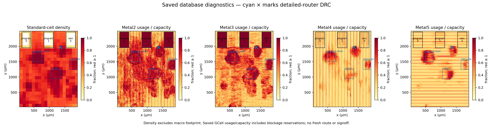
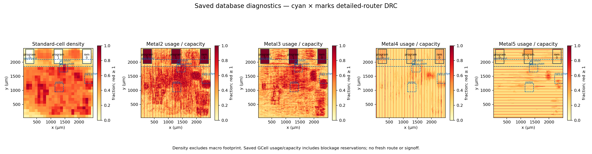

# BD routing, coupling and power-grid investigation

The new 2.25 × 2.53 mm layout routes with zero violations. The retained old
1.94 × 2.53 mm layout has one real Metal2 short. This investigation
keeps routing DRC, electrical limits, extracted relative timing, coupled noise
and power-grid integrity as separate gates. A clean router result alone does
not qualify an asynchronous chip.

## Withdrawn physical results

All routed/extracted electrical and timing conclusions made before the wire-R
unit and explicit SPEF-load fixes in `78e7869` are **void**. This includes the
first-P&R and 1.94/3.93 mm rectangular campaigns and their derivative reports.
Their archived databases, DRC failures and cell-footprint counts remain useful
historical observations; they cannot qualify a current layout, establish a wire
margin or justify a guard reduction. Do not silently relabel or overwrite them.

The `pnr-bd-routability-2530x2530-r7` routing used corrected resistance units.
Its original `extract*-electrical.rpt` files still used estimated parasitics and
are also **void**. The later `pnr-adapter-cap-extract-{min,max}-r7-r1` audits and
the 640-case campaign below explicitly load the independent SPEFs and replace
those electrical/local-timing results. They remain diagnostic because electrical
violations, composed launch/return paths and noise qualification are open.

The current mapping/placement batch adds compact keeper placement and parent
output drivers. It must reroute and re-extract: old margins cannot be
transferred across those buffer and wire changes. First rerun native feeder cap,
loaded slew and keeper coupling, then the still-needed local/composed timing.
No new timing-closure claim may precede electrical repair.

## Compact native primitives and parent drivers (in progress)

The fixed-tool runs at 2.25, 2.30 and 2.35 mm width pass detailed routing with
zero violations, empty DRC reports, all 26,230 protected native cells and all
10,327 placement groups. Independent nominal/minimum/maximum RC extraction is
complete for all three. The README uses the smallest tested successful candidate,
`build/native-physical/pnr-2250x2530-d50-r1`, rendered in
`build/native-physical/render-2250-r1/layout.png`. The source map remains
`map-bd-r4`, before the new A/B boot ROM; this layout does not qualify that ROM.

The 2.25 mm cell footprints total **3.469786 mm²**: logic 2.858175, SRAM
0.466241 and taps/endcaps 0.145371. Core occupancy is 64.27%; density in the
available standard-cell area is 60.89%. The die is 15.98% larger than the former
1.94 × 2.53 mm outline, rather than the 30.41% increase to 2.53 mm width.

The matched 2.35 mm run totals **3.494115 mm²**: logic 2.875229, SRAM 0.466241
and taps/endcaps 0.152645, at 61.90% core occupancy. Its 411 keeper groups span at
most 25.20 µm; their median is 11.20 µm. All 9,916 output-parent groups span at
most 63.84 µm, with median 12.32 µm. The former 525 µm victim's keeper group
spans 11.76 µm. These are placement bounding boxes, not routed wire lengths or
noise margins. The 2.35 mm extracted electrical/coupling campaign is diagnostic;
its results do not qualify the different wires in the 2.25 mm layout.

The final-flow 1.94, 2.05 and 2.20 mm runs still reject placement or global-route
legalization/compaction; their logs remain under `pnr-1940x2530-d55-r3`,
`pnr-2050x2530-d55-r3` and `pnr-2200x2530-d50-r4`. The earlier
2.35 mm r2 router output had zero violations but its receipt rejected a tool
source change during the run; r3 reruns with fixed tool inputs rather than
waiving that rejection.

The physical follow-up leaves RTL, handshake protocols and protected primitive
graphs unchanged. Each AsymmetricC keeper's AOI21, NOR2 and first output buffer
form one placement group. Every live driven native output gets an ordinary
parent-side buffer; native feedback stays on the source side. Passive aliases
and unused outputs get no buffer. The full graph proof and a separate exclusive
feeder check reject changed logic, external bypasses and orphan cells.

GPL groups use exact OpenDB objects. Detailed placement searches 100 µm for
ordinary logic, with a 500 µm retry from the saved starting placement, but the final bounding box of each native group must fit
within **64 µm on each axis**, after every legalization, repair and routed
checkpoint. That is an engineering placement constraint, not a capacitance or
noise-immunity limit. Extracted native-to-parent load and keeper coupling still
decide qualification. Short source-to-parent links are protected against another
uncontrolled branch. A parent output remains locked if the same net enters a
protected native input; the receiver-boundary correction below addresses this
remaining repair limitation.

The first trial (`build/native-physical/map-bd-r2`) exposed blanket pre-placement
sizing: all 9,916 new `buf_2` drivers became `buf_8`, although only 52 parent-output
violation rows appeared beforehand. The parents alone cost 0.565958 mm². The
pinned resizer's optional early sizing pass promotes eligible drivers using a
capacitance-ratio heuristic and does not count those changes in its printed
resize total. Of these parents, 5,726 have one sink; median TT pin loading is
0.004473 pF. `buf_8` also loads its native source about 3.7 times as much as
`buf_2`. The follow-up removes `-pre_placement`, retaining violation-driven
slew/capacitance/fanout repair, unchanged limits and later wire-aware repair.
These are geometry and loading observations, not an energy estimate.

The violation-driven r4 map passes the complete graph proof, all 26,230 protected
native cells and all 9,916 exclusive output parents. Repaired logic is 2.234365
mm², only 0.034614 mm² above the immediate parent's recipe; the parents account
for 0.174720 mm². The [area ledger](area-ledger.md) retains both recipes.

The first 2.20 × 2.53 mm, 50%-density trial stopped with 80 legalization failures
under a global 20 µm displacement limit. That failed trial remains archived.
Increasing the ordinary search radius does not change the 64 µm native acceptance
bound. Width/density candidates must share the final mapping/repair recipe and
reach zero router violations before comparison or README adoption.

The initial matched width sweep exposed limits after electrical repair:

| Width / density | Last accepted checkpoint | Rejected next checkpoint |
| --- | --- | --- |
| 1.94 mm / 55% | Floorplan | 18 ordinary legalization failures after placement repair |
| 2.05 mm / 55% | Clock | 30 ordinary legalization failures after global-route repair |
| 2.20 mm / 50% | Clock | Native group 502 spread to 86.24 µm after global-route repair |
| 2.35 mm / 50% | Clock | Native group 529 spread to 66.64 µm after global-route repair |

The 2.20 mm placement itself passed all 10,327 groups (maximum 58.24 µm after
repair). Soft GPL clustering alone did not keep later DPL moves compact. Each
failed run remains under `build/native-physical/pnr-*`; none replaces the README
render or qualifies a smaller die.

The follow-up collects every oversized group and tries bounded local repacking
before rerouting. Other cells are temporarily fixed; local legalization searches
48 µm around deterministic first/midpoint/last neighborhoods. The first attempt
holds the first member's legal space. Every attempt retains the **same 64 µm
acceptance bound**, checks whole-chip legality, and restores original statuses.
Failed attempts preserve a diagnostic database and restore coordinates,
orientations and statuses before retrying, even if diagnostic writing fails.
Routed/extracted checkpoints cannot be repacked. Fresh global routing follows
any accepted repack after wire repair.

A real OpenROAD fixture on the 2.20 mm clock checkpoint injects an 84 µm
displacement into group 502. Local packing restores legal geometry, all 10,327
groups pass, and every nontarget instance remains unchanged. A fully blocked
placement rejects all attempts and restores the starting database geometry.
Evidence: `build/native-physical/repack-fixture{,-blocked}.log`. Fresh 1.94, 2.05
and 2.20 mm runs rejected isolated repacking. The later accepted routes listed
above use the regional fallback below.

The next fallback selects ordinary neighbors whose complete bounding boxes lie
within 96 µm of a bad group's first member. Neighboring native groups are released
only in their entirety, and originally fixed cells remain fixed. This movable
set is computed once from the saved legal baseline. The 96 µm radius selects
neighbors; it is not a final fence. DPL still searches 48 µm and every native
group still must fit the 64 µm bound. Outside geometry and all original placement
statuses are checked/restored. Failed trials roll back before retrying.

`build/native-physical/repack-fixture-regional.log` exercises that fallback on
the real 2.20 mm database, with deliberate isolated-attempt failures. Regional
placement passes legality and all 10,327 groups, with maximum displacement
45.9 µm; cells outside the selected region are unchanged. This proves the
fallback mechanism, not convergence of a production checkpoint. The blocked
fixture and Tcl property controls check rollback, full-group boundary selection
and fixed-cell exclusions. New width runs use this flow in fresh directories.

The five-receiver isolation trial at 2.35 mm exposed one further legalization
case: regional packing fixed four frame-store output pairs but stretched a
neighboring pair to 80.64 µm. The run correctly stopped at the unchanged 64 µm
gate. A regional trial may now make one bounded corrective repack, keeping its
exterior fixed and rolling back both levels on failure. It cannot recurse again
or relax the span, per-invocation DPL search bound or pin checks. The search bound
is not a limit on cumulative movement from initial seeding. Replaying the original failed
checkpoint passes legality and all 10,330 groups in
`build/native-physical/repack-cascade-integrated/`; a fresh complete route is
still required. The original failure and nested rollback controls are retained.
Independent review corrected colliding nested diagnostic names. The final
372-property Python gate is `build/native-physical/cascade-ci-r2`; every failed
nested attempt now keeps its own evidence.

Independent review found no outstanding source/doc issue and independently
verified that all 927 control-connected parent outputs remain covered by NDR
traversal; payload-only outputs retain their existing classification. The fast
gate `build/native-physical/ci-r2` passes 366 Python and 197 Scala tests. The
buffer-kind correction and current Python suite also pass in `ci-r3` (366 tests).
The independently reviewed repack passes 367 Python tests in `ci-r4`, including
fixed-cell and failed-diagnostic rollback controls. The previous committed batch
also passes GitHub CI at `d1e6fcd`.
The regional fallback has an independent review with no remaining source finding;
the working-tree Python gate passes 370 tests in `ci-r5`, including the three
new generic boot-slot properties being verified as a separate batch.
These checks approve the implementation; they do not qualify unfinished routing,
extracted electrical limits, composed timing or coupled noise.

### Extracted electrical results and remaining receiver locks

The accepted 2.35 mm route has **zero adapter-output capacitance violations**
across all 10,609 measured native outputs, all five PVT corners and both min/max
RC extractions. Both `electrical-2350-{min,max}-r3` audits explicitly load the
appropriate SPEF and resolve every pin limit. This closes that inventory's
previous 165–235 wire-dominated failures, not all whole-chip Liberty limits.
Several ordinary-driver capacitance failures remain, including the frame
publication parent buffer at the slow/hot corner.

| PVT | Min-RC slew violation rows / worst ns | Max-RC slew violation rows / worst ns |
| --- | ---: | ---: |
| TT 25 °C | 1,299 / 11.686 | 1,548 / 14.393 |
| SS 125 °C | 6,074 / 22.656 | 10,649 / 28.087 |
| SS −40 °C | 1,877 / 14.861 | 2,329 / 18.330 |
| FF 125 °C | 1,072 / 10.242 | 1,310 / 12.598 |
| FF −40 °C | 651 / 7.666 | 732 / 11.251 |

Evidence: `build/native-physical/slew-2350-r3/report.json`. The slow/hot max-RC
rows cover 2,190 nets: 709 native-locked, 433 on which repair made no progress,
and 1,048 ordinary/clock nets. Slew is worse than the previous layout; no timing
margin from this netlist is accepted as closure.

Independent review found that locking every native input net also blocks
ordinary distribution upstream of that input. Of the 709 locked violating nets,
450 have ordinary external drivers. The five worst boundaries are I²C update
payload `d[13]`/`d[14]`, frame publication guard `a`, and completion RAM/memory
guard `a`. Each has one protected receiver; frame publication has 342 total
loads. The bounded correction is a noninverting isolation buffer outside each
measured receiver boundary, compact with that receiver. Its short local net stays
locked; the upstream distribution becomes repairable. Primitive bodies, full
graph proof and subsequent protected-pin snapshots remain unchanged. No blanket
per-bit buffering or relaxed electrical limit is authorized by this result.
The correction is implemented in `native-input-isolation.json` for those five
measured BD boundaries only. Historical comparison mappings explicitly skip it;
missing current-design targets remain fatal. Two reusable properties cover
shared ancestors, flattened repair graphs, invalid boundary selections and
bypass/polarity/internal-partition faults. Placement groups include each new
buffer and its protected receivers, and exclusivity is checked after every
checkpoint. The unchanged graph proof passes all 26,230 native cells in
`build/native-physical/map-bd-input-r1`; `input-locks-r1.json` confirms that all
five upstream nets are free of protected receivers while all local nets remain
protected. Python verification passes 372 tests in `input-ci-r2`, and independent
review is closed. The matched `pnr-input-2350x2530-d50-r1` reroute and extracted
electrical/timing checks remain pending; no physical improvement is claimed yet.

The compact-placement run also removes the observed flip in the previously
failing program-Join keeper. `build/native-physical/keeper-2350-r3/results.json`
records 100 cases (five PVT corners, min/max RC, both stored states, quiet/rising/
falling coherent aggressors at 20 ps and 2 ns), plus 20 half-step refinements.
All settle without an owner transition; the maximum keeper excursion is
27.020 mV and the maximum owner-output excursion is 0.003 mV. The receipt passes.
This is a repeated representative experiment on the same logical victim, not
whole-chip noise qualification or evidence transferable to the 2.25 mm wires.

The same 2.35 mm checkpoint passes static PDN connectivity/voltage coverage for
98,945 logic/SRAM instances. With the existing ideal perimeter-feed assumptions,
the normalized 1.3 mA load gives 0.217 mV maximum combined VDD/VSS drop; the
synthetic vectorless 29.363 mA case gives 5.129 mV. Evidence and maps are in
`build/native-physical/ir-2350-r3/`. These are static sensitivity screens, not
firmware power, transient wake droop or package/board qualification; the feed,
resistance and SRAM limitations in the power-grid section still apply.

### Custom C-element option

A custom cell is a plausible longer-term way to keep the keeper state wire
inside one characterized layout. Use the existing reduced `set`, `hold` and
`reset` equation so all asymmetric variants retain their protocol; a chain of
binary C-elements is not equivalent. Include the first output isolation stage
inside the cell. Keep any separately required output delay as a measured timing
obligation, rather than assuming the custom cell supplies it.

This option needs transistor sizing, LEF/GDS/CDL views, DRC/LVS, retention/reset
and coupled-noise checks, per-corner Liberty characterization, a reviewed internal
feedback timing model and interface load limits. No custom cell has been added,
and no area/noise improvement is claimed before those measurements. It does not
provide MUTEX arbitration or qualify independent competing requesters.

## Where the old layout is congested

The old layout is `build/pnr-bd-1940x2530-r1`, mapped from `baec57b`'s
generic-MCU inputs. It predates the current single-writer Telemetry RTL.
`report_routability.py` reads the routed instance geometry and saved global-route
GCell usage/capacity without changing either database.



| Region (µm) | Local cell density | Identifiable owners |
| --- | ---: | --- |
| 100 × 100 box around the short at (1360.8, 1965.9) | 92.91% | Mostly flattened SoC logic and repair; original owner unavailable |
| Below-left SRAM: (450,1500)–(750,1800) | 97.48% | Mostly flattened logic/repair, then CTS and Telemetry |
| Right edge: (1650,1250)–(1909.6,1550) | 89.28% | Transactions, RAM access, core |
| Centre: (1050,950)–(1350,1250) | 94.43% | Flattened logic/repair, I²C, Control |

Density includes logic and physical-cell footprints, excludes macro footprint
from the available area, and is local rather than the whole-core 75.23% figure.
Ownership is based on surviving instance hierarchy; flattened gates are not
assigned to a module by guesswork. The short connects ordinary OAI/AOI logic,
not SRAM signal pins. All saved GCell layers have zero overflow despite this
detailed-routing failure. GCell reservations include blockages and must not be
confused with routed-wire area.

Evidence: `build/pnr-bd-1940x2530-routability-r2/`, including raw instance/GCell
exports, map, coordinates, owner areas and one run receipt.

## Retained 2.53 mm routed comparison

The retained `ed38c62` BD map completed detailed routing on **2.53 × 2.53 mm**
with **zero router violations**, an empty retained DRC report and independent
nominal/minimum/maximum RC extraction. All 26,230 protected native cells and
18,936 selected control-net NDR assignments survive routing. This accepts the
route, not electrical, noise or timing signoff.



The map combines final routed instance geometry with saved global-route GCells.
Every layer has zero global overflow. Whole-core footprint occupancy is 55.80%;
standard-cell density excluding macros is 52.14%. Total cell footprint is
3.398069 mm²: logic 2.767025, SRAM 0.466241 and taps/endcaps 0.164802.

| Region (µm) | Local cell density | Identifiable owners |
| --- | ---: | --- |
| Below SRAMs: (1300,1650)–(1600,1900) | 72.98% | Flattened SoC logic/repair, Telemetry, SPI ADC |
| Centre: (1150,950)–(1450,1250) | 62.46% | Flattened logic/repair, Telemetry, Control command bridge |
| Right edge: (2200,1250)–(2499.84,1550) | 56.13% | Transactions, RAM source, admission |
| Lower SRAM band: y = 1850–2100 | 27.06% | Flattened logic/repair and RAM access; density excludes macros |

Small 100 µm pockets remain dense: a flattened SoC/ADC bin near (1480,1780)
is 96.08%, a CPU bin near (2180,380) is 92.13%, and an I²C/flattened bin near
(680,1180) is 91.63%. Those pockets remain priorities for extracted coupling
and timing, even though the router found legal paths.

Evidence: `build/pnr-bd-routability-2530x2530-r7/`,
`build/pnr-bd-routability-route-r7/` and `build/pnr-bd-routability-render-r7/`.
The original short's coordinate now partly overlaps the moved middle SRAM;
its empty standard-cell area is not a same-location logic improvement.

The same current map was tried first at 1.94 × 2.53 mm with a 60% placement
target (`pnr-bd-routability-1940x2530-r6`). The SRAM-band keep-outs reduced the
former-short box from about 93% to 33% local occupancy, but the centre/right
regions stayed near 94%/90%. It finished with 1,288 violations: 1,091 shorts,
195 metal-spacing, one non-sufficient-metal and one cut-short report. Extraction
was correctly blocked. The accepted retry uses a 50% target with the same halos,
SRAM-band limit and native-net spacing recipe. It does not establish the
smallest feasible die. The old reference layout also uses older RTL, so changes
against it cannot be attributed solely to floorplanning.

## Repair recipe

Current experiments use `build/single-writer-telemetry/map-bd-r7` from `ed38c62`,
with 2.010204 mm² mapped and 2.199751 mm² repaired logic before placement.
This is not an isolated floorplan comparison against the older RTL above.

- Keep all three SRAMs in R0. Their 36 signal pins lie on the south Metal2 edge,
  already facing the logic. Flipping them north would face the narrow die margin.
- Add hard placement halos: 24 µm at the sides/top and 40 µm at the signal-pin
  edge. Align tap-cell row cutting with these keep-outs.
- Use a 50% partial placement region across the lower SRAM band. In pinned
  OpenROAD, GPL honours `max_density`, but DPL treats a non-soft partial region
  as hard. Explicitly set the region soft after creation; the CLI ignores
  `-soft` when `-max_density` is also present. Hard macro halos remain hard.
- Apply a 2× spacing, unchanged-width NDR to typed native control leaves and
  their buffer/inverter branches. Recompute the selection after repair and
  verify it again after detailed routing. Payload D/Q alone do not select a net.
- Require both the router's final count and its retained DRC report to be empty
  before extraction can proceed. Keep failed databases and logs.
- Rebuild global guides from the complete repaired placement after electrical
  repair. The pinned incremental 3-D maze router aborts with GRT-0183 (heap
  underflow) on the program-source reservation C-element in trial r5. Fresh
  routing retains the NDRs and every protected connection; it waives no path.

The investigation also found a pre-existing resistance-unit bug. GF180 Liberty
declares ohms; the flow supplied fitted kilohms/µm values directly. `set_units`
only checks the requested units in this OpenSTA build; it does not change them.
The flow now converts the fit numerically through the STA unit APIs before
`set_layer_rc` and checks the resulting database sheet resistance. Metal2–5
read back as 0.108041, 0.0578684, 0.0472105 and 0.0348822 Ω/□. This avoids a
1000× underestimate during placement/global-route electrical repair. Independent
SPEF extraction has its own units.

Failed trials remain under `build/pnr-bd-routability-*`: early placement trials
exposed the hard/partial blockage API behavior above; the first legal trial was
stopped after the unit check showed that `set_units` had not corrected wire R.
Neither trial is qualifying evidence. The corrected run starts again from the
mapped inputs, including placement and clock-tree construction.

### Electrical coverage limitation

The repaired global checkpoint still violates electrical limits. The five
corner reports contain 1,302 / 8,710 / 1,938 / 701 / 270 slew violations
(TT, SS hot, SS cold, FF hot, FF cold respectively), with worst slews of
8.66 / 15.97 / 11.17 / 7.39 / 5.29 ns. These are estimated global-route results,
not extracted timing closure.

Independent review also found that this OpenSTA version stores per-pin
`set_max_capacitance` constraints but does not consult them when reporting
capacitance violations. Its two reported capacitance failures per corner cover
Liberty limits only: they do **not** cover the native adapter's 0.05 pF pin
limits. A separate read-only audit must compare each constrained driver's actual
load with the intended pin limit. Do not interpret the ordinary report's small
count as complete electrical coverage or relax the adapter limit to match it.

The direct global-checkpoint audit measures all 10,609 constrained outputs at
every corner, with no missing pins. It finds 213 / 215 / 210 / 217 / 215 definite
0.05 pF violations in the same corner order. These use coherent STA load values,
not a sum of independently maximal components. Evidence:
`build/pnr-adapter-cap-global-r4/`. The audit completes successfully as a
measurement; its electrical verdict is **adapter-capacitance-failures**.
All failing output nets load receivers outside their own protected primitive.
Wire capacitance dominates on 183–187 of them, depending on corner. The worst
I²C publication output has about 0.374 pF total load, of which 0.352 pF is wire,
and only six external receivers. Parent-side buffering/placement is therefore
the main follow-up; increasing the adapter limit would hide the problem.
Until electrical limits close, timing reports can include Liberty-table
extrapolation. The extracted campaigns below are diagnostics, not permission
to shorten a guard or accept a marginal path.

The wider r7 global checkpoint reduces adapter-capacitance failures to
178 / 181 / 177 / 183 / 181, with complete measurements at the same 10,609 pins.
Worst load is 0.304119 pF on the I²C observation output driving `sdaLow`, including
0.254119 pF of wire capacitance. Slew failures remain 1,129 / 7,173 / 1,770 / 883 /
222 rows, with worst values 8.97 / 17.39 / 11.44 / 7.85 / 5.17 ns. Widening the
floorplan therefore improves congestion without closing electrical limits.
Independent graph and ODB checks reproduce all 26,230 protected cells and the
55,129 native anchors on 18,936 constrained nets.
Evidence: `build/pnr-adapter-cap-global-wide-r7/` and
`build/pnr-wide-r7-independent-summary.json`.

### Final extracted electrical results

Fresh audits explicitly load each independently extracted SPEF into STA. In
TT / SS hot / SS cold / FF hot / FF cold order:

| Check | Minimum RC | Maximum RC |
| --- | --- | --- |
| Slew violations | 972 / 5,165 / 1,444 / 662 / 160 | 1,184 / 10,215 / 1,899 / 955 / 234 |
| Worst slew, ns | 7.06 / 13.70 / 9.00 / 6.18 / 4.07 | 8.40 / 16.30 / 10.71 / 7.35 / 4.84 |
| Native 0.05 pF output-limit violations | 165 / 165 / 164 / 166 / 166 | 230 / 233 / 226 / 235 / 234 |

All 10,609 constrained native outputs resolve at every corner. The maximum-RC
worst output is the completion `memory_ack` gate, at 0.266–0.267 pF, including
0.254 pF of wire. Wire capacitance dominates 215–223 of the failing maximum-RC
nets. Most failures are ClosingLatch outputs, especially Core, RAM and I²C.
The ordinary Liberty-capacitance report finds only one maximum-RC violation
in the first four corners and none at FF cold; it omits the adapter constraints.

Evidence: `build/pnr-electrical-extract-{min,max}-r7-r1/` and
`build/pnr-adapter-cap-extract-{min,max}-r7-r1/`. Independent graph comparison
also finds the routed graph identical to the global checkpoint, with only
permitted physical tie-instance renaming during extraction.

The original flow's extraction reports are **not authoritative**: OpenRCX wrote
SPEF but did not replace STA's estimated parasitics. Those reports are retained
unchanged. The flow now explicitly reads the extracted RC into every PVT scene
before reporting; the separate fresh audits above use that same explicit load.

## Noise and timing obligations

The pinned router tapers NDRs near pin access and its final DRC does not establish
complete NDR spacing coverage. Assignment is therefore reported as
**constrained, unqualified**, not a shielding or noise-immunity proof.
Extracted coupling must be examined at the actual protected receiver leaves.

`check_gf180_coupling.py` inventories the extracted native nets and ranks their
coupling. Its distributed-RC screens are sensitivities, not receiver thresholds.
`check_gf180_keeper_coupling.py` adds a bounded transistor experiment: select an
eligible internal C-element net by measured external coupling, retain the whole
mapped keeper and its extracted feedback wires, and load external sinks from
the corner's Liberty pin capacitances. Both reset-reached holding histories,
quiet controls, rising/falling aggressors and timestep refinement are required.
An extra owner output transition or retained-state flip fails; unsettled final
state also fails. Internal analog excursions are recorded separately.

The transistor experiment still uses ideal boundary/aggressor sources and
schematic cell models, without cell-internal extracted RC or statistical
mismatch. It is representative noise evidence, not an immunity guarantee for
every handshake wire or every arrival time.

### Final extracted noise findings

The r7 minimum- and maximum-RC inventories each account for all 18,936 native
nets: 18,838 have extracted networks and 98 are independently proved singleton
terminals without routed wire. There are no unexplained omissions. Among 2,277
eligible internal C-element victims, selection takes the largest external
coupling and the largest distinct-owner candidate in a current hotspot region.
Both selected victims have terminals in the broad r7 macro region
(y = 1854–2497.04 µm); this sample does not cover the narrower lower SRAM band
or the centre/right density pockets. Historical hotspot coordinates remain
separately labelled. Evidence:
`build/native-coupling-r7-{min,max}-r1/` and
`build/native-si-selection-r7-r2/`. The two-victim distributed-RC screens retain
their separate sensitivity-only verdict.

The strongest victim is `lane_2_join.ca_child_left.ca_primitive_a`'s retained
`state`, with 40.450 / 45.700 fF external coupling at minimum / maximum RC.
Its adjacent feedback gates `u4`/`u5` sit near (1082,2395) µm, but first output
buffer `u6` is about 363 µm away. The state wire totals 525.28 µm: 96.88 on M2,
372.96 on M3 and 55.44 on M4, with 11 vias. Its M3 trunk parallels `net13337`
for 348.32 µm and `gpioOut[0]` for 159.60 µm, both at 1.12 µm centerline
separation. These aggressors contribute 24.635 and 10.348 fF at maximum RC;
`lane_3_join_out_req` contributes another 5.932 fF. These decoded overlaps do
not assign individual extracted capacitors to segments or prove metal-edge
clearance. Evidence: `build/keeper-forensics-r7-r4/`.

**The ideal fast-edge stress fails.** With the complete nonlinear keeper and
actual extracted wires, coherent 20 ps full-rail rising aggressors flip a held
low owner and its retained state at all five PVTs and both RC views. All ten
failures survive timestep halving (maximum measured voltage difference
2.28 µV). The failed receipt is retained in `build/native-keeper-r7-v0-r1/`.
Its 100 primary cases include 20 stable quiet controls; no other primary case
flips. The second owner, `lane_3_join.out_req_ca_primitive_rendezvous`, selected
at internal delay node `n10`, completes 100 primary cases plus 12 refinements
without transition; its largest Q departure from the held rail is 6.371 mV
(`build/native-keeper-r7-v1-r1/`).

The 20 ps linear ramp represents only 8 ps at Liberty's 30–70% slew thresholds.
The fastest observed loaded slew across all 29 contributor cell terminals,
five PVTs and both RC views is 98.881 ps. Even the smallest transition-table
entry across the actual aggressor cells' characterized inputs and loads is
41.24 ps; neither comparison proves a universal physical edge bound. A narrow
supplement uses each aggressor's fastest positive saved-constraint loaded slew,
converts it to a full-rail ramp by 2.5, and aligns all 50% crossings. All 20
held-low/rising and held-high/falling cases plus 20 refinements remain settled
without owner transition. Q stays within 4 µV of its held rail, although the
largest victim-terminal excursion is 1.548 V. Evidence:
`build/keeper-loaded-slew-r7-r1/` (pass receipt; largest refinement difference
0.111 mV). This conditional result does not erase the fast-edge stress failure.

Only two owners and two histories of one holding condition per owner are
covered. Ideal equipotential aggressors do not prove legal simultaneous
switching; propagated STA slews depend on upstream constraints, feedback cuts
and the tool's automatic loop breaks. The schematic cells omit cell-internal
extracted RC and supplied MOS diffusion areas/perimeters default to zero.
Statistical mismatch, supply noise
and qualified receiver immunity thresholds remain absent. Independent review
found no remaining implementation issues in the keeper, geometry, slew or
supplemental experiment. A concrete robustness follow-up is to cluster the
keeper core and first output buffer, then separate or shield the remaining
state route from the identified aggressors, preserving the state function and
rerunning extraction and timing. These experiments do not demonstrate that the
20 ps condition occurs in silicon or establish whole-design noise closure.

### Routed timing method

`native_stage_timing.py --routed <run>` uses a fresh netlist exported from the
verified extracted database and independently generated min/max SPEF. It retains per-corner Liberty,
loaded capture trees, source slews and ACK receivers. Its results are conditional
local stage bounds; complete upstream launch, reset, mismatch and receiver-noise
qualification remain separate obligations. Unmatched SPEF annotations fail.
The 0.05 mm² routed hold-repair reserve remains available for failing composed
paths; no guard is shortened on the basis of these local checks alone.

The extraction audit covers all load-bearing drivers, including competing paths
that are absent from an extremal timing report. Unloaded exclusions require
actual database connectivity. Every pinned SPEF-reader diagnostic from
STA-1640 through STA-1657 fails the audit, including unit and name-map errors.
Cross-RC envelopes pair fast control/ACK with slow data/capture at the same cell
corner and input slew; unresolved constituents remain explicit obligations.

The initial routed reruns exposed two analysis-tool problems, with failed logs
retained under `build/pnr-routed-timing-smoke-r*`. OpenROAD's Tcl stdout transport
corrupted records longer than 4 KiB; bounded writes now preserve the exact TSV
record, verified independently over twelve lengths through 65,536 characters.
More seriously, OpenROAD 26Q2's static loop discovery ignored the explicit keeper
cuts and automatically disabled Control's active C-element B-to-ZN arc. Its
dynamic-loop experiment did not finish within a useful bound and was retained
as unresolved, not used for measurements.

The pinned standalone OpenSTA 2.7.0 uses constraint-aware loop discovery
([source revision 857316ff](https://github.com/The-OpenROAD-Project/OpenSTA/blob/857316ff001b2a8dbbdc5996944d08a6d38c87ab/search/Levelize.hh)).
The identical request context resolves all 646 capture queries there with the
actual routed netlist and minimum-RC SPEF. Independent review requires a fresh
ODB-derived netlist, that reader's own annotation coverage, and rejection of
active automatic loop cuts on alternative source-to-target paths. Neither an
invented load nor a new timing waiver replaces the missing paths.

The retained Control smoke (`build/pnr-routed-timing-smoke-r15/`) completes at TT,
0.2 ns launch slew, with both extracted RC views and their conservative cross-RC
envelope. All 88,624 driver identities match; every load-bearing driver is
annotated and every queried target passes the automatic-loop-cut audit. The
cross-RC local bounds are **−14.929 ns allowed data lag**, **+1.675 ns zero-reuse
hold**, and **+1.979 ns ACK after capture**. Negative allowed lag means Control
needs data stable before its request; only a composed upstream-launch check can
decide setup. This is a successful measurement, not a timing pass. The broader
32-stage, five-PVT, two-slew, min/max-RC campaign is recorded below; the smoke
does not stand in for those cases.

The independently reviewed period control
(`build/pnr-routed-period-control-r1/`) changes only 1000 to 2000 ns and reproduces
all 5,180 parsed rows across the six min/max-RC contexts exactly, including paths,
slews, electrical records and margins. Apertures are conservative per-PVT maxima
over the characterized Liberty setup/hold tables, not an interpolation at each
receiver's measured slew. The period check does not qualify electrical violations
or provide upstream launch credit.

Two full-campaign contexts aborted in standalone STA: Completion reply request
and core address common-path analysis. The instrumented Completion probe
localizes its crash to the whole-graph arrival update, before constructing the
path iterator; the address log alone does not localize its internal failure.
The local helper now asks
for arrivals through the target's graph level, then uses the same iterator and
root/polarity/path checks. Independent review of the pinned STA source supports
this for local combinational and explicitly launched phase paths; it is not a
replacement for transparent-latch-chain or general full-chip analysis. Neither
trigger computes required times or slack. Failed runs remain under
`pnr-routed-stages-r7-hotspots-0-r1` and `pnr-routed-stages-r7-remaining-0-r1`.

The generated-only diagnostic in `build/pnr-reply-arrival-probe-r1/` resolves all
66 Completion request queries with the unchanged strict parser. The reviewed
`build/pnr-control-arrival-equivalence-r1/` reproduces all 5,180 Control rows,
paths, slews, apertures, margins and cross-RC bounds exactly after the trigger
change. The fresh production smoke `build/pnr-routed-timing-smoke-r16/` also
reproduces the complete r15 records exactly; the comparison is retained in
`build/pnr-routed-smoke-equivalence-r16.json`. This checks the analyzer change,
not physical timing closure. The period control repeated on that corrected
analyzer (`build/pnr-routed-period-control-r2/`) again reproduces all 5,180 rows
and complete derived results exactly at 1000 versus 2000 ns.

### Routed canonical-stage results

All **32 canonical BD stages** resolve at five cell PVTs, 0.02/2 ns input slews
and both extracted RC views: **640 cases and 320 conservative cross-RC
envelopes**, with no missing cases. Each consumed result and the expected stage
inventory match their run-receipt hashes; aggregation checks the exact Cartesian
product and rejects duplicates. Completion, core address and CRC use the clean
`r2` reruns. The failed grouped `r1` runs remain retained and are excluded.

These are local bounds, not composed setup slack. Positive allowed data lag
means data may arrive that much after the request; a negative value requires
data to arrive earlier. Zero-reuse hold assumes the source may reuse its data
immediately upon ACK at the measured receiver, without additional source
retention credit. Each table entry is the minimum across its group's instances,
corners and slews; the three minima need not come from the same case.

| Stage group | Allowed data lag, ns | Zero-reuse hold, ns | ACK after capture, ns |
| --- | ---: | ---: | ---: |
| ADC assemble/prepare | +20.927 | +1.319 | +1.510 |
| ADC finish | +15.355 | +0.521 | +0.715 |
| ADC radix steps | -132.685 | +1.119 | +1.313 |
| CPU address | +19.179 | +1.067 | +1.261 |
| CPU execute | +69.164 | +0.925 | +1.119 |
| Completion reply | +20.871 | +2.163 | +2.357 |
| Control CRC | +13.583 | +0.961 | +1.155 |
| Control update | -29.962 | +0.903 | +1.097 |
| Elapsed step | -233.389 | +0.968 | +1.162 |
| Housekeeping update | -50.874 | +0.883 | +1.077 |
| I2C update | +14.341 | +0.894 | +1.088 |
| Program SRAM issue/capture | +20.108 | +1.238 | +1.432 |
| Telemetry update | +15.651 | +1.612 | +1.806 |
| Transaction reply | +21.904 | +1.639 | +1.833 |
| Working SRAM issue/capture | +20.164 | +1.136 | +1.330 |

Sixty envelopes require upstream data lead: Control, Housekeeping, elapsed and
the three ADC radix stages. Elapsed is worst at SS hot, 2 ns input slew. All
local hold/ACK bounds are positive, but ADC finish's **0.521 ns** hold and
**0.715 ns** ACK bounds are small. These results contain the electrical-limit
violations tabulated above and do not include mismatch derates. Repair those
limits and compose actual launch/retention before accepting margins or changing
guards. Insert hold cells only on failing composed paths; the **0.05 mm²**
hold-repair reserve remains unspent.

Within these 32 stages, the request-delay cell inventory locates two chains
intersecting the lower SRAM band: program lane 3 capture,
bbox (877.5,1991.4)–(1033.2,2348.1) µm, and
working-RAM lane 1 issue, (2028.3,1858.1)–(2186.2,2387.3) µm. Both are covered
above. Elapsed's request-chain cells lie near the lower edge,
(1442.0,62.7)–(1775.2,180.3) µm. These are cell bounding boxes, not wire-route
coverage or attribution of a timing failure to congestion.

Evidence: the successful `build/pnr-routed-stages-r7-*/` runs and
`build/pnr-routed-stage-summary-r7/{summary.json,stages.csv,request-guard-locations.json}`.
The summary records the exact contributing runs. Custom controllers,
Join/FIFO launch compositions, clocked bank readers, full reset distribution,
pulse widths and receiver-noise immunity are outside this canonical-stage sweep.
The empty-stage capture template does not close BD pending admission or both
return-order scenarios.
There is no full-chip timing-closure claim.

## Power-grid screening

The accepted 2530 × 2530 µm r7 extracted checkpoint passes full VDD/VSS
terminal connectivity and voltage coverage for all 88,589 logic/SRAM instances.
The final static analysis uses 604 explicit ideal perimeter source nodes per
rail at 3.3 V, zero external resistance, and TT 25 °C Liberty models for the
synthetic STA case. The normalized case assigns 1 mA across standard cells in
proportion to footprint area and 0.1 mA to each of the three SRAMs.

| Checkpoint and assumed load | Total current | Maximum VDD loss | Maximum VSS rise | Maximum local combined drop |
| --- | ---: | ---: | ---: | ---: |
| Final extracted r7, normalized | 1.300 mA | 0.103 mV | 0.114 mV | 0.217 mV |
| Final extracted r7, synthetic STA activity | 31.108 mA | 2.563 mV | 2.802 mV | 5.365 mV |
| Retained global r7, normalized | 1.300 mA | 0.103 mV | 0.114 mV | 0.217 mV |
| Retained global r7, synthetic STA activity | 30.877 mA | 2.561 mV | 2.800 mV | 5.361 mV |

The final STA case explicitly reads `routed-nom.spef` into a fresh process;
the retained global case uses placement-estimated signal RC. Both use vectorless
activity of 0.002 transitions/ns and 0.5 duty, plus clocks from the checkpoint
SDC (20 MHz service/work, approximately 12 Hz LF, and a 400 kHz I2C-start
reference). These are assumed load scenarios, not measured firmware activity or
active/sleep power estimates. All nominal/minimum/maximum signal SPEFs exist for
the accepted PNR run; this IR comparison uses nominal signal capacitance only.

The middle program SRAM, `soc/fabric_program_macros_1`, remains worst at bbox
(1114.35, 1954.00)–(1415.65, 2469.81) µm. The worst standard cell is
`clkbuf_3_5_0_soc\/ca_child_spi_adc\/net1559`, bbox
(1285.76, 1901.20)–(1300.32, 1905.12) µm, at 4.606 mV combined drop in the
final synthetic case (4.578 mV at the global checkpoint).

Regional maxima below use instances whose footprints intersect each box.
They conservatively combine each instance's minimum VDD and maximum VSS
terminal voltage; they are not an interpolated voltage at the box center.
Cell density follows the routability report's available-area convention.

| Region and bounds, µm | Cell density | Normalized maximum | Final synthetic maximum | Limiting synthetic instance/owner, lower-left µm |
| --- | ---: | ---: | ---: | --- |
| Former short: (1310,1915)–(1410,2015) | 0% | 0.217 mV | 5.365 mV | Program1 SRAM; (1114.35,1954.00) |
| Below-left SRAM: (450,1500)–(750,1800) | 57.08% | 0.126 mV | 3.821 mV | Control CRC; (744.80,1767.92) |
| Former right: (1650,1250)–(1909.6,1550) | 61.96% | 0.138 mV | 4.125 mV | Housekeeping update; (1648.08,1524.88) |
| Former center: (1050,950)–(1350,1250) | 61.38% | 0.138 mV | 4.400 mV | Service-clock buffer; (1315.44,1168.16) |
| Current center: (1150,950)–(1450,1250) | 62.46% | 0.138 mV | 4.400 mV | Service-clock buffer; (1315.44,1168.16) |
| Current right: (2200,1250)–(2499.84,1550) | 56.13% | 0.082 mV | 2.287 mV | Transactions `gain362`; (2188.48,1309.28) |
| SRAM band: (30.24,1850)–(2499.84,2100) | 27.06% | 0.217 mV | 5.365 mV | Program1 SRAM; logic-only maxima 0.150/4.606 mV |
| Dense ADC/flattened: (1430.24,1731.36)–(1530.24,1831.36) | 96.08% | 0.150 mV | 4.407 mV | `clkbuf_0_soc\/net1530`; (1425.20,1756.16) |
| Dense core: (2130.24,331.36)–(2230.24,431.36) | 92.13% | 0.060 mV | 1.106 mV | Core register-file x15; (2129.12,431.20) |
| Dense I2C/flattened: (630.24,1131.36)–(730.24,1231.36) | 91.63% | 0.114 mV | 3.125 mV | `soc/wire7658`, owner unresolved; (726.88,1211.28) |

The former-short box now intersects the moved SRAM and contains no standard
cells; its result is not evidence of improvement for the original logic at that
location. High cell density alone does not determine the maximum IR drop.

Final evidence and maps are in `build/pdn-ir-routability-r7/`, with a passing
`receipt.json`, `summary.json`, both-rail CSVs, and `normalized-drop.svg` /
`sta-drop.svg`. The retained global comparison is in
`build/pdn-ir-routability-global-r7/`. Reproduce into a fresh directory with:

```sh
python tools/check_pdn_ir.py build/pnr-bd-routability-2530x2530-r7 build/pdn-ir-r7-repeat --checkpoint extract
python -m unittest discover -s tools -p test_check_pdn_ir.py -v
```

The runner overrides automatic ideal M5 supply-pin sourcing with explicit ring
and perimeter-strap sources. It separates manually assigned loads from STA
power into different processes because pinned PDNSim adds the two. Grid sheet
resistance is the nominal flow fit; M1 and via/cut resistance remain unqualified
LEF fallbacks. Signal SPEF supplies STA signal capacitance and does not extract
the power grid. SRAM internal supply-grid drop is absent.

For comparison, the retained old 1940 × 2530 µm layout gives 0.224 mV at
normalized 1.3 mA and 0.447 mV at 2.6 mA, scaling within 1 µV of CSV rounding;
its synthetic 34.055 mA case gives 5.638 mV. Evidence remains in
`build/pdn-ir-baseline-r1/` and `build/pdn-ir-baseline-scale2-r1/`.

These are static sensitivity checks with optimistic ideal perimeter feeds.
Actual supply-pad locations, package/board impedance, workload switching, SRAM
current envelopes and allowable droop are still needed for power-integrity
qualification. Transient wake droop, decap and inductance are not modeled. No
deep-sleep or active-power claim follows from the synthetic numbers.

## Verification and independent review

The initial flow/tool batch passes the fast gate in
`build/pnr-routability-ci-r1/`: 336 Python and 197 Scala tests. No RTL, ABI,
watchdog/reset contract or native timing policy changed. Follow-up review caught
the partial-blockage API behavior, the ineffective `set_units` call and gaps in
SPEF coverage. Those fixes pass 56 focused tests and fresh independent review.
The software rerun in `build/pnr-routability-ci-r2/` passes 346 Python tests,
including the independently reviewed keeper experiment. The
`build/pnr-routability-ci-r3/` passes 353 Python tests after the independently
reviewed per-pin capacitance audit and its immutable-input checks. The latest
`build/pnr-routability-ci-r6/` passes **360 Python tests**, including the reviewed
routed reader, alternative-path loop audit and driver-identity checks. A synthetic 100×
coupling fault in the historical pilot produces a false owner event and
retained-state flip and is rejected. This negative control does not qualify
nominal routed silicon.
Actual route, extracted timing and receiver-noise results remain separate from
these software and functional checks.
