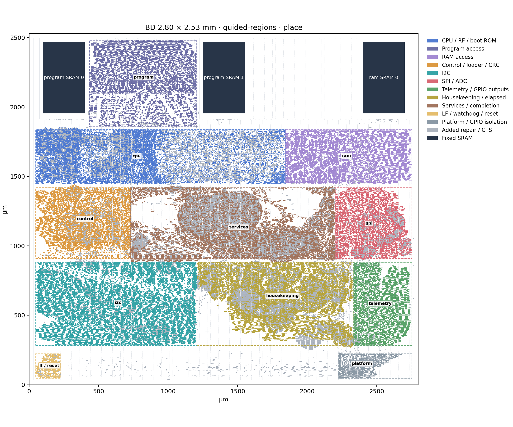

# BD hierarchical floorplan

This experiment preserves the major BD blocks through synthesis, places them
in separate regions, and measures the resulting wires. It does not
change the ABI, native protocols, periodic clocks or Click implementation.
Placement regions are not power islands.

At the user's request on 2026-10-19, the remaining r13 campaigns were stopped
and their evidence retained. The three unrestricted arms stopped during global
routing/repair; guided 2.80 mm/65% stopped during detailed routing with unresolved
violations. These are cancellations, not completed routing verdicts. The guided
55% arm had already failed placement. No r13 candidate has an accepted complete
route or extracted comparison. The README uses the previously completed
2.35 × 2.53 mm receiver-isolation route instead. The module-coloured image
below remains explicitly a placement study.

## Matched comparisons

Two different comparisons answer different questions:

1. **Synthesis:** ordinary hierarchy retained versus flattened, with the same
   exported RTL, mapped primitive recipes, Liberty, Yosys and ABC. Native
   primitives retain their exact internal graphs in both arms. This measures
   the area cost of hierarchy, before electrical repair.
2. **Placement:** unrestricted versus guided module placement of the *same*
   repaired hierarchical netlist. Die, SRAM locations, pin positions, routing
   rules, density and tools match. This separates placement effects from changes
   in synthesis. Earlier layouts used different RTL and are historical context.

`EmitHierarchicalBd` preserves Services, the LF timebase, watchdog and reset
coordinator that the normal export inlines. Native major owners already retain
their hierarchy. The option defaults off and is BD-only. The paired export test
compares external ports and semantic contract inventories; boot, watchdog
recovery and shared-SPI sleep scenarios also run on the preserved export.

`compare_synthesis_hierarchy.py` verifies the reference's recorded tool and
source hashes before starting the flat arm. Both arms retain the complete native
cell/pin/net recipes and three fixed SRAM macros. An ordinary hierarchy boundary
may retain unused port logic that flattening removes; its area is part of the
measured cost, not silently excluded.

The matched synthesis run (`map-r4`, `flat-map-r3`) measures **1.971463 mm²**
with hierarchy and **1.893700 mm²** flattened, excluding SRAM: **+0.077763 mm²
(4.11%)**. Both preserve all 1,137 native recipes and the three fixed SRAMs.
The hierarchical map repairs to **2.196947 mm²** before placement. No repaired
flat-synthesis number is inferred from this comparison.

Periodic sinks are **3,069 flat versus 3,273 hierarchical**: service
1,188→1,253, work 1,803→1,942, LF unchanged at 78. The separate SDA event and
three SRAM clock pins remain. These counts trace real mapped clock connectivity;
ordinary cell ownership is not reconstructed from flattened ABC names.

## Placement plan

The three SRAMs stay across the top with south-facing signal pins, placement
halos and the existing low-density pin-escape band. The first trial sizes regions
from the actual repaired mapped cell area at 60% fill. Those regions exclude the SRAM
band. Actual occupancy includes taps and subsequently added repair/CTS cells.
Fences snap inward to the LEF site/row grid and are checked against every
OpenDB row before use. On the 2.53 mm outline their resulting mapped fills are
60.3–61.0%; the snapped coordinates and fills are recorded in `module-regions.json`.

| Region | Initial position and contents |
| --- | --- |
| CPU | Below the program SRAMs; CPU, register file and native fetch/boot-ROM routing |
| Program access | Initially below the program SRAMs; the repair-budgeted trial uses their inter-macro gap |
| RAM access | Below the working SRAM |
| Control | Between the program side and the left I²C boundary; loader and CRC |
| Services | Beside Control and the peripheral owners; clocked coordination and completion crossings |
| I²C | Left side, towards its three digital boundary pins |
| SPI/ADC | Right side, towards its ADC boundary pins |
| Telemetry | Lower right, towards GPIO output pins |
| Housekeeping | Lower centre, including elapsed scaling |
| LF/reset | Bottom-left corner; independent timebase, watchdog and reset qualification |
| Platform | GPIO isolation and remaining top-level plumbing; explicitly not attributed to Services |

Transport siblings follow their native owner. Existing native placement groups
remain indivisible, including parent buffers across hierarchy boundaries.
Unmatched native owners fail classification rather than being assigned by guess.
Mapped constant tie cells are listed separately: floorplan tie-fanout repair
replaces them. Their area stays in region sizing, while functional seed/spill
inventories exclude them. Total physical occupancy counts the actual replacement
ties. Missing functional or native seed cells remain fatal.

The first experiment used unattached `SUGGESTED` (DEF GUIDE) regions and movable
seeds, followed by unrestricted Nesterov placement. It failed the intended
arrangement: after placement/repair, 99% of LF/reset area and 90% of Control area
had left their regions. Its roughly 2.4% lower pre-repair wire-length estimate
does not make that a successful hierarchical floorplan. `--module-seeds` retains
this experiment and reports spill; these guides are not fences.

The bounded trial uses `EXCLUSIVE` regions and explicit OpenDB groups. Every
original functional cell must remain in its assigned group with its complete
bounding box inside the region. Native compact groups cannot straddle module
groups. New repair/CTS/tie cells are assigned before legalization by location,
or by a unique connected region if no region contains their location. Shared
boundary helpers may remain outside; the append-only helper table records these
decisions. Grouped helpers also undergo the independent bounds check. Physical
fixed cells and SRAMs remain outside the module groups.

Permanent bounds failed after electrical repair. The legal initial placement
passed all module and native checks, but repair added 23.6% cell area unevenly:
CPU reached 99.36% of its region, Services 102.40%, and Platform 109.12%, before
tap occupancy. Both 100 and 500 µm legalizer searches failed; the latter cannot
repair an actual area deficit. This failure is retained in
`place-overflow15-r1`.

The **guided candidate** (`--module-guides`) keeps the bounded GPL and first
fully legal placement, then releases only the module groups before repair.
Their rectangles remain unattached `SUGGESTED` guides. Release must preserve
every instance's location, orientation, status, master and pin connections.
No unrestricted GPL follows it: repair and local legalization may spill into
available space. Native 64 µm bounds, feeder isolation, complete graph proofs,
placement legality and zero router DRC stay mandatory. Later stage processes
verify that the groups remain released. The real-design control preserves all
77,168 original cells and 9,966 native groups; a deliberately restored exclusive
guide is rejected.

Final reports include spill, area-weighted module centres and mean/maximum
centre displacement from `guided-legal.odb`, using each final cell's area as
the weight. Routing completion alone does not establish a successful module
floorplan. If the arrangement is lost, regions must be resized using measured
repair overhead rather than accepting the scattered result.

Both placement arms first try incremental legalization with compact native
members held in place. Before electrical repair, the flow snapshots the exact
compact-group inventory, masters and legal geometry. Same-master members retain
those legal positions; resized parents remain movable. Protected cells outside
compact groups receive no additional placement freeze. Initial placement and
CTS, which have no pre-repair baseline, retain the protected-leaf-only trial.
Temporary fixed statuses exist only during legalization, never during repair.
Final native span, feeder, graph and placement checks remain mandatory. A failed
trial restores the complete **post-repair** starting placement before fallback,
without undoing resized masters or inserted buffers. Existing fixed members
must retain their exact master, geometry, orientation and status; they are never
demoted for the trial. A mismatched fixed baseline fails closed.

This addresses the `r11` global-repair failure: ordinary legalization scattered
417 source/parent pairs, while keeper groups stayed compact. A retained
real-design diagnostic restores 20,339 same-master group cells and leaves six
resized parents movable; all 9,966 groups and full placement legality pass.
The production helper passes the same diagnostic and rollback properties.
It does not qualify the new wires: accepted routing/extraction must be rerun.

The first guided repair still failed local native repacking. Diagnostic 96 and
160 µm searches did not produce an accepted solution: the former left four
ordinary logic cells unplaced, and the latter exceeded the native span limit.
The production search and span limits are unchanged.

The next candidate budgets each owner from the larger of its mapped area and
its measured post-placement repair area. The optional `--module-repair-budget`
input binds the source checkpoint, netlist, module and native inventories;
missing, changed or mismatched inputs fail. That failed checkpoint supplies
area planning only, never timing or placement qualification. Its assigned logic
totals 2.861808 mm², with another 0.010392 mm² of ungrouped helpers and
0.164802 mm² of taps/endcaps reported separately.

This candidate uses 62% **band-adjusted planning fill**, distinct from the
initial mapped fill. Fixed physical occupancy is reported separately; the
planning figure is not free legal-site capacity. Program access occupies the
gap between its SRAMs, above CPU/RAM access. Control remains beside Services
and I²C. The 2.80 × 2.53 mm outline is 10.67% larger than 2.53 mm square.
It is an experiment, not evidence that the smaller die cannot work. Compare
guided and unrestricted placement on the same outline before attributing an
improvement to hierarchy. Keep the 2.53 mm unrestricted run separately.

Reports separate owner fill from total occupancy, including foreign/added cells
and taps. The original mapped-area trial sizes regions at 60%; the later
repair-budgeted trial uses 62% band-adjusted planning fill. The matched GPL
placement target is 65%, allowing
room for legalization and native clusters. GPL may raise its effective target
after inflation. The guided 65% run logs density updates as high as 86.89%;
those update lines do not identify the region. Thus 65% is the initial target,
not a claim about final effective density.
The matched arms use GPL's 0.15 continuous-overflow stopping criterion. At 0.10,
the small Platform region oscillated near 0.12–0.14 while the density penalty
grew to a nonfinite value (`r7`). Stopping the continuous optimizer earlier does
not accept overlaps: discrete placement legality, module/native bounds, graph
preservation and zero router violations remain mandatory. Record the resulting
overflow, legalization displacement and congestion separately.

The first bounded attempt exposed a pinned GPL defect: full-core blockage
dummies were charged to every region, producing 0.828853 mm² of fixed area even
in smaller regions and eventually `GPL-0305`. The candidate OpenROAD patch
clips dummy geometry and fixed-cell area to each region and honors actual row
holes. Physical blockages, SRAM halos and fences remain intact. See the
[runtime patch and controls](../physical/gf180/openroad/README.md).
The final accounting scope is uniform-row physical module groups. The initial
unrestricted patch regressed the mixed-site UPF test; its failure remains in
the evidence. Power-domain and mixed-site flows retain upstream behavior, and
the MCU runner requires the corrected-mode diagnostic. Logical placement
regions do not qualify a future always-on power domain.

The next attempt reached detailed placement and exposed a separate legalizer
search defect. A fractional fence corner can round outside both axes of the
clipped search rectangle, disconnecting a four-neighbour search from every
legal site. Increasing displacement from 100 to 500 and 1,200 µm did not fix it.
The candidate projects only the search seed into the unchanged rectangle.
Occupied-site, full-cell, fence and displacement checks remain in force.
Production fences also align to complete rows/sites; neither change relaxes
the native 64 µm compaction bound.

Native keeper gates and their first buffer retain the existing 64 µm per-axis
compaction gate after legalization and repair. That placement bound is not a
routed-length or coupling-immunity limit. `report_module_layout.py` enumerates
every internal net of every mapped C-element, resolves its real pin-connected
OpenDB net, and records routed length, pin HPWL and min/max extracted RC. Missing
or duplicate inventory rows fail. Total coupling includes internal feedback;
external-aggressor ranking and transient immunity require the separate keeper
campaign.
`celement-longest-nets.csv` gives one longest-net row per C-element; the JSON
retains all internal nets.

## Reports and limits

The fresh `r13` placement checkpoints are **before global routing**, not
final extracted results. Compare the two 65% / 2.80 mm arms for the isolated
module-placement effect; the 55% rows are separate density/outline controls.

| Placement | Die, mm | GPL target | Logic after placement repair, mm² | Added buffer area at placement, mm² |
| --- | --- | ---: | ---: | ---: |
| Unrestricted | 2.53 × 2.53 | 55% | 2.729424 | 0.460672 |
| Unrestricted | 2.80 × 2.53 | 55% | 2.735079 | 0.466340 |
| Unrestricted | 2.80 × 2.53 | 65% | 2.712635 | 0.449349 |
| Guided modules | 2.80 × 2.53 | 65% | 2.929286 | 0.647435 |
| Guided modules | 2.80 × 2.53 | 55% | Rejected after repair | — |

The `r11` 65% unrestricted controls stopped at first global routing with 329
and 554 overflow units (2.53 mm and 2.80 mm respectively). Guided 2.80 mm reached
zero first-pass overflow, then failed legalization after global electrical
repair (5,362 new buffers and 538 resizes). The separate 2.53 mm/55% control also
reached zero first-pass overflow; it was deliberately stopped during repair
when superseded by the corrected anchoring flow. None is an accepted final
route. The subsequent `r13` comparison uses fresh guided/unrestricted 2.80 mm
arms at 55%, plus a separate unrestricted 2.53 mm control, with the identical
corrected repair flow in all arms. The 55% guided GPL reaches its iteration limit. Initial legalization passes
the native/module bounds, but after repair adds 40,770 buffers and resizes
11,619 cells, all legalizer/repack alternatives fail the unchanged compaction
gate (`NATIVE_REPACK_NO_LEGAL_NEIGHBORHOOD`). That candidate is rejected.
The 65% guided arm has its own fresh 65% unrestricted control, so density and
module placement remain separate comparisons.

The added-buffer column uses the graph-proven inventory, including inserted
`dlyb_1` delay buffers. It excludes resized-cell area and later CTS/global-repair
additions. The superseded first geometry report omitted delay buffers; its
under-counted buffer column is not used. The guided placement costs 0.216651 mm² more logic than the matched
unrestricted placement. Original owner spill is below 1% except Services
(3.47%). Its mean displacement from the initial legal region placement is
7.46 µm for Services and at most 5.78 µm for the other owners. The module layout
survives repair, but this alone does not establish an electrical or area benefit.
Final placement logic occupancy (including inserted helpers) is 67.57% in CPU,
63.66% Housekeeping, 62.94% Services, 62.72% RAM, 62.70% Control, 62.65% I2C,
62.32% SPI, 59.64% LF/reset and 58.15% Telemetry. Program access is 50.59% of
its full rectangle (the reduced-density SRAM band is accounted separately),
and Platform is 43.33%. Taps/endcaps add about 2.8 percentage points. These
measured occupancies are separate from both region sizing and GPL targets.

The guided candidate completes global routing after electrical repair with
zero overflow: wire length rises from 10,504,326 to 13,215,526 microns after
5,495 buffers and 529 resizes. The full graph, feeder and native compactness
checks pass. Logic is 3.110921 mm2; SRAM is 0.466241 mm2 and taps/endcaps
0.184226 mm2, totaling 3.761387 mm2. At their final masters, electrical-repair
buffers occupy 0.815420 mm2 and CTS buffers 0.021127 mm2. This reconciles the
original cells, resizes and additions without counting delay buffers as free.
Detailed routing and extracted qualification remain separate.
The normalized static IR check on this final placement measures 0.226 mV worst
effective drop at 1.3 mA (1 mA distributed by logic footprint, 0.1 mA per SRAM),
covering 106,439 instances. The historical flat 2.53 mm result is 0.217 mV under
the same load model, on different RTL. Both use ideal perimeter supplies;
package resistance, transient wake droop and macro-internal PDN are absent.



This placement image uses actual instance rectangles and hierarchy paths.
Dashed rectangles are the released module guides; gray cells are added helpers.
It is not the completed routed layout.

Run evidence is kept under `build/hierarchical-floorplan/`. The module image is
rendered from real instance rectangles and hierarchy paths, with SRAM labels and
guide outlines. It is not an illustrative block diagram.

Acceptance keeps separate gates for zero router DRC, graph preservation, native
compaction, all-corner extracted electrical limits, coupled keeper noise,
power-grid drop, and composed native timing. A positive local margin with a slew
outside the Liberty table remains diagnostic. Static IR uses the documented
normalized/synthetic activity models, not a measured workload or package model.
No earlier routed timing is transferred to these new wires.

An independent audit of the frozen r13 global graph found incomplete native
NDR propagation: the explicit transparent-cell walk omits `clkinv`. Its 18,723
selected nets expand to 19,578 (+855) when clock inverters are included; some
missing branches carry request, ACK or capture. Adding `dlyb`/`dlyd` changes no
further nets in this graph. The next frozen flow must include those transparent
cell types with checked input/output pins and reroute. Current r13 measurements
remain diagnostic and cannot establish complete native-distribution NDR coverage.

The unrestricted 65% global-router log also emits `GRT-0273`: FastRoute
internally lowers an NDR net's resource cost while searching for guides. The
pinned source leaves its OpenDB NDR assignment intact, so assignment checks can
still pass. This is another reason that assigned NDR, zero global overflow and
zero base-rule router violations do not prove geometric double spacing or noise
immunity. Detailed-route geometry and coupled-noise checks are separate gates.

Digital validation passes the fast CI gate (198 Scala tests), three focused
hierarchical boot/watchdog/shared-SPI cases, export parity, generation audit and
the RDC proof. The final Python property run passes 387 tests. The candidate
OpenROAD runtime passes all 7,631 packaged tests and the focused region/search
negative controls. Independent review corrected delay-buffer accounting, region accounting scope,
legalizer rollback, repair-budget inventory binding and partial-band capacity;
the resulting affected tests pass. Review also corrected fixed-member handling
in the repair baseline trial; both its rollback property and real-design
diagnostic pass. Physical results retain separate verdicts.

## Reproduction

Use the configured, pinned Yosys 0.62 and ABC for both synthesis arms, and the
patched OpenROAD 26Q2 build for placement/routing. The mapper's repair tool is
also fixed in the recorded physical-tool configuration. The one-hour synthesis
timeout accommodates the full generic boot ROM; it is not a circuit deadline.

```sh
python tools/sbt.py "physical/runMain riscay.physical.EmitHierarchicalBd build/hierarchy/export"
python tools/gf180_physical.py build/hierarchy/export/bd build/hierarchy/map
python tools/gf180_implement.py build/hierarchy/map --configured-yosys --synthesis-timeout 3600
python tools/gf180_constraints.py build/hierarchy/map
python tools/compare_synthesis_hierarchy.py build/hierarchy/map build/hierarchy/flat-map
```

The matched 65% placement comparison uses the retained `map-r4` and measured
`repair-budget-r1.json` under `build/hierarchical-floorplan/`. With those local
inputs present, run into fresh directories:

```sh
python tools/gf180_pnr.py build/hierarchical-floorplan/map-r4 build/hierarchy/unrestricted --die-width-um 2800 --die-height-um 2530 --placement-density 0.65 --module-repair-budget build/hierarchical-floorplan/repair-budget-r1.json --openroad /path/to/pinned/OpenROAD
python tools/gf180_pnr.py build/hierarchical-floorplan/map-r4 build/hierarchy/regional --die-width-um 2800 --die-height-um 2530 --placement-density 0.65 --module-guides --module-repair-budget build/hierarchical-floorplan/repair-budget-r1.json --openroad /path/to/pinned/OpenROAD
python tools/report_module_layout.py build/hierarchical-floorplan/map-r4 build/hierarchy/regional build/hierarchy/layout --png
```

A newly generated map needs its own measured budget. Its JSON contains
`owner_area_um2` for every owner, `sources` naming the netlist, native inventory,
module inventory and source checkpoint, and `inputs_sha256` for those files.
Use post-repair group cell footprints, reconcile ungrouped helpers and fixed
physical cells separately, and retain the source checkpoint even when its
legalization failed. The tool rejects a budget from a different netlist or
native/module inventory. Generated reports and measured budgets remain local
evidence, not checked-in design constants.

Use fresh output directories, and keep audited sources unchanged while a
campaign runs. The same geometry report can be generated for the unrestricted
arm. Its occupancy, internal-net inventory and render come from the final
database; the seed checkpoint alone is not the result.
